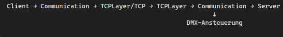

# Projektstruktur
MME2019.sln \
├── Network/   gemeinsame TCP- und Kommunikationsschicht \
├── Client/    Client-Anwendung \
├── Server/    Server-Anwendung mit DMX-Anbindung \
└── DMX/       eigenständiges DMX-DLL-Testprogramm

# Aufgaben der Projekte
•	Network bildet die gemeinsame Kommunikationsbasis. TCPLayer kümmert sich um TCP-Verbindungen und Sockets. Darauf setzt Communication auf: Es verwaltet Nachrichten, Callbacks und einen Worker-Thread. OS_depend enthält betriebssystemspezifische Teile. \
•	Client verbindet sich über Communication mit einem Server auf Port 8000. Der Servername wird als Kommandozeilenargument erwartet. \
•	Server startet ebenfalls auf Port 8000 und verwendet einen ServerCallbackHandler, um auf Verbindungen und Nachrichten zu reagieren. Dieser Handler ist außerdem mit der DMX-Steuerung verbunden. \
•	DMX ist ein separates Konsolenprogramm zum direkten Ansteuern von DMX-Kanälen. DmxDllAccess lädt dafür zur Laufzeit DMX510.dll.

# Abhängigkeiten und Nachrichtenfluss
Client und Server verwenden beide Network. Der Kommunikationsfluss ist damit grob: \
\
Der Network-Ordner enthält zusätzlich eine eigene main.cpp mit einem einfachen Client-/Server-Beispiel. Sie ist jedoch nicht in allen Build-Konfigurationen aktiv; in Release|Win32 ist sie ausgeschlossen. Die eigentlichen **Anwendungseinstiegspunkte** liegen in **Client\Client.cpp** und **Server\Server.cpp**.

